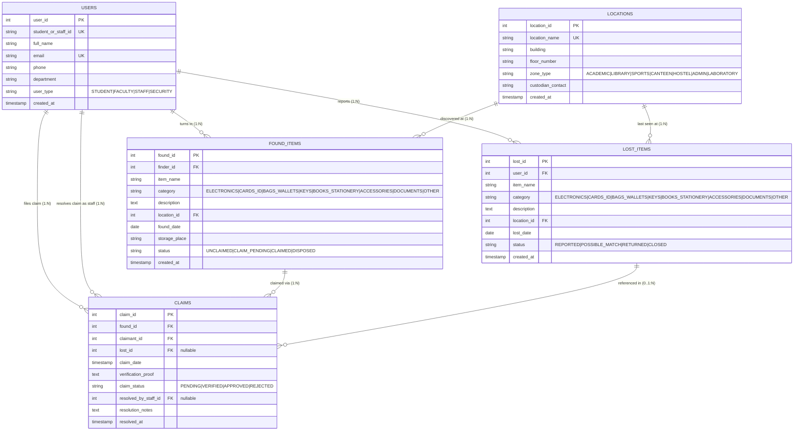

# Entity-Relationship (ER) Diagram & Relational Mapping
**Project:** Campus Lost-and-Found Record Matching System  
**Course:** B.Tech Computer Science & Engineering — DBMS Minor Project  
**Database Name:** `campus_lost_found`  
**Database Engine:** MySQL 8.0+ (InnoDB)

---

## 1. Visual Mermaid ER Diagram



---

## 2. Textual / ASCII ER Diagram (For Viva & Print Submissions)

```text
 +-----------------------------------------------------------------------------------+
 |                                   CAMPUS USERS                                    |
 | (user_id [PK], student_or_staff_id [UQ], full_name, email [UQ], phone, dept, type)|
 +-----------------------------------------------------------------------------------+
       | 1                           | 1                         | 1          | 1
       | reports                     | turns in                  | files      | verifies
       |                             |                           | claim      | claim
       v N                           v N                         v N          v N
 +------------------------+    +-------------------------+   +----------------------+
 |       LOST_ITEMS       |    |       FOUND_ITEMS       |   |        CLAIMS        |
 | (lost_id [PK],         |    | (found_id [PK],         |   | (claim_id [PK],      |
 |  user_id [FK],         |    |  finder_id [FK],        |   |  found_id [FK],      |
 |  item_name,            |    |  item_name,             |   |  claimant_id [FK],   |
 |  category,             |    |  category,              |   |  lost_id [FK, Null], |
 |  description,          |    |  description,           |   |  claim_date,         |
 |  location_id [FK],     |    |  location_id [FK],      |   |  verification_proof, |
 |  lost_date,            |    |  found_date,            |   |  claim_status,       |
 |  status)               |    |  storage_place,         |   |  resolved_by [FK],   |
 +------------------------+    |  status)                |   |  resolution_notes,   |
       ^                       +-------------------------+   |  resolved_at)        |
       | N                                  ^                +----------------------+
       |                                    | 1                         ^
       | last seen at                       | discovered at             |
       +--------------------+   +-----------+                           |
                            |   |                                       |
                            v   v                                       |
                  +-----------------------+                             |
                  |       LOCATIONS       |                             |
                  | (location_id [PK],    |                             |
                  |  location_name [UQ],  |                             |
                  |  building,            |                             |
                  |  floor_number,        |                             |
                  |  zone_type,           |                             |
                  |  custodian_contact)   |                             |
                  +-----------------------+                             |
                                                                        |
        +---------------------------------------------------------------+
        | Links Found Item to Claimant and Optional Lost Report
        v
    [CLAIMS Resolves M:N Relationship between USERS and FOUND_ITEMS]
```

---

## 3. Entity Descriptions

### 1. `Users`
- **Purpose:** Stores demographic and authentication details for all campus community members interacting with the system.
- **Primary Key:** `user_id` (Auto Increment Integer)
- **Alternate Candidate Keys:** `student_or_staff_id` (Unique), `email` (Unique)
- **Role:** Parent table referenced by `Lost_Items` (as reporter), `Found_Items` (as finder), and `Claims` (as claimant or security resolver).

### 2. `Locations`
- **Purpose:** Centralized catalog of campus zones, buildings, laboratories, sports grounds, and hostelling blocks.
- **Primary Key:** `location_id` (Auto Increment Integer)
- **Alternate Candidate Key:** `location_name` (Unique)
- **Role:** Parent table referenced by both `Lost_Items` and `Found_Items` to enforce standardized naming and avoid misspelling.

### 3. `Lost_Items`
- **Purpose:** Records user-reported lost personal property, last-seen date/location, and description keywords.
- **Primary Key:** `lost_id` (Auto Increment Integer)
- **Foreign Keys:**
  - `user_id` references `Users(user_id)` with `ON DELETE CASCADE ON UPDATE CASCADE`.
  - `location_id` references `Locations(location_id)` with `ON DELETE RESTRICT ON UPDATE CASCADE`.

### 4. `Found_Items`
- **Purpose:** Records turned-in property recovered across campus, logging discovery date, physical custody desk, and claim status.
- **Primary Key:** `found_id` (Auto Increment Integer)
- **Foreign Keys:**
  - `finder_id` references `Users(user_id)` with `ON DELETE CASCADE ON UPDATE CASCADE`.
  - `location_id` references `Locations(location_id)` with `ON DELETE RESTRICT ON UPDATE CASCADE`.

### 5. `Claims`
- **Purpose:** Associative entity recording ownership claims filed against found items, tracking verification evidence, security staff resolution, and handover notes.
- **Primary Key:** `claim_id` (Auto Increment Integer)
- **Foreign Keys:**
  - `found_id` references `Found_Items(found_id)` with `ON DELETE CASCADE ON UPDATE CASCADE`.
  - `claimant_id` references `Users(user_id)` with `ON DELETE CASCADE ON UPDATE CASCADE`.
  - `lost_id` (Nullable) references `Lost_Items(lost_id)` with `ON DELETE SET NULL ON UPDATE CASCADE`.
  - `resolved_by_staff_id` (Nullable) references `Users(user_id)` with `ON DELETE SET NULL ON UPDATE CASCADE`.

---

## 4. Cardinality and Participation Constraints

| Relationship | Cardinality | Participation | Description |
| :--- | :---: | :---: | :--- |
| **Users to Lost_Items** | $1 : N$ | Optional (0..N) | A user may report 0, 1, or multiple lost items. Every lost item must belong to exactly 1 user (Total participation on Lost_Items). |
| **Users to Found_Items** | $1 : N$ | Optional (0..N) | A user (student/staff/security) may turn in 0, 1, or multiple found items. Every found item must have 1 recorded finder. |
| **Locations to Lost_Items** | $1 : N$ | Optional (0..N) | A campus location may have 0 or more lost item reports. Every lost item must be linked to 1 valid campus location. |
| **Locations to Found_Items** | $1 : N$ | Optional (0..N) | A campus location may be the recovery spot for 0 or more found items. |
| **Found_Items to Claims** | $1 : N$ | Optional (0..N) | An unclaimed found item has 0 claims initially. Multiple claimants may attempt to claim an item before verification is finalized. |
| **Users to Claims** | $1 : N$ | Optional (0..N) | A user can file 0 or more claims over time. Every claim must have 1 claimant user. |
| **Lost_Items to Claims** | $0..1 : N$ | Optional (0..N) | A claim may optionally reference an existing lost item report (nullable foreign key), or be filed independently. |
| **Users (Staff) to Claims** | $0..1 : N$ | Optional (0..N) | A claim is assigned to a staff/security resolver upon review. Unreviewed claims have `NULL` resolver. |

---

## 5. Relational Schema Mapping (DDL Representation)

```text
Users(user_id [PK], student_or_staff_id [UQ], full_name, email [UQ], phone, department, user_type, created_at)

Locations(location_id [PK], location_name [UQ], building, floor_number, zone_type, custodian_contact, created_at)

Lost_Items(lost_id [PK], user_id [FK -> Users.user_id], item_name, category, description, 
           location_id [FK -> Locations.location_id], lost_date, status, created_at)

Found_Items(found_id [PK], finder_id [FK -> Users.user_id], item_name, category, description, 
            location_id [FK -> Locations.location_id], found_date, storage_place, status, created_at)

Claims(claim_id [PK], found_id [FK -> Found_Items.found_id], claimant_id [FK -> Users.user_id], 
       lost_id [FK -> Lost_Items.lost_id, Nullable], claim_date, verification_proof, claim_status, 
       resolved_by_staff_id [FK -> Users.user_id, Nullable], resolution_notes, resolved_at)
```

---

## 6. Normalization Analysis (1NF through BCNF)

### First Normal Form (1NF)
- All attribute values are atomic (e.g., phone numbers and names are single atomic strings; dates and timestamps are discrete).
- No repeating groups or multivalued attributes exist.
- Each table defines a formal primary key.
- **Conclusion: The schema satisfies 1NF.**

### Second Normal Form (2NF)
- The schema is in 1NF.
- All candidate keys in all tables consist of single attributes (`user_id`, `location_id`, `lost_id`, `found_id`, `claim_id`).
- Since no composite primary key exists, partial functional dependency ($X \rightarrow Y$ where $X \subset \text{Primary Key}$) is mathematically impossible.
- **Conclusion: The schema satisfies 2NF.**

### Third Normal Form (3NF)
- The schema is in 2NF.
- No transitive dependencies ($X \rightarrow Y \rightarrow Z$) exist where non-prime attributes determine other non-prime attributes.
- In `Lost_Items` and `Found_Items`, location attributes (`building`, `zone_type`) are not stored directly; rather, they are normalized into `Locations` and linked via `location_id`.
- User details (`full_name`, `department`) are not duplicated in `Lost_Items`, `Found_Items`, or `Claims`; they reside exclusively in `Users`.
- **Conclusion: The schema satisfies 3NF.**

### Boyce-Codd Normal Form (BCNF)
- A relation $R$ is in BCNF if, for every functional dependency $X \rightarrow Y$, $X$ is a superkey.
- In `Users`: `user_id` is a candidate key; `student_or_staff_id` and `email` are alternate candidate keys. Any determinant is a superkey.
- In `Locations`: `location_id` and `location_name` are candidate keys.
- In `Lost_Items`, `Found_Items`, and `Claims`: Every determinant is a primary key or superkey.
- **Conclusion: The entire database schema strictly adheres to BCNF.**
